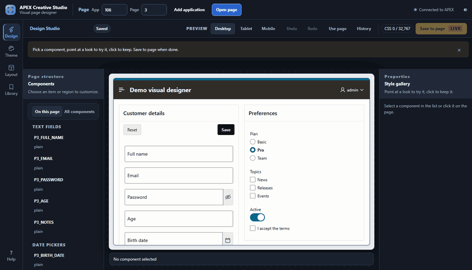

# APEX Visual Designer plug-in

A native Oracle APEX region plug-in (26.1 or later) that gives any application a Flutter (Material 3) style
designer. Add the region to a page, open another page of a registered application, pick a design
for each region, item and button, and save: the generated CSS and JavaScript go into that page.
A Theme Designer sets one look for the whole application and pushes it as a single CSS file.
A Layout Board rearranges a page's regions and items on the 12-column grid and applies the new layout in one step, with undo.

- Install: import the plug-in, add the region, done. Details: [docs/INSTALL.md](docs/INSTALL.md)
- Using it: [docs/USER_GUIDE.md](docs/USER_GUIDE.md)
- Security: [docs/SECURITY.md](docs/SECURITY.md)

Requires Oracle APEX 26.1 or later (tested on 26.2). License: MIT.
